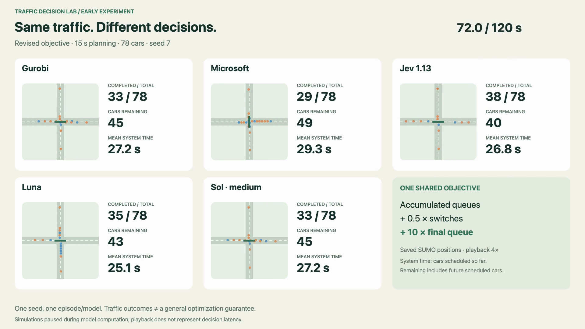
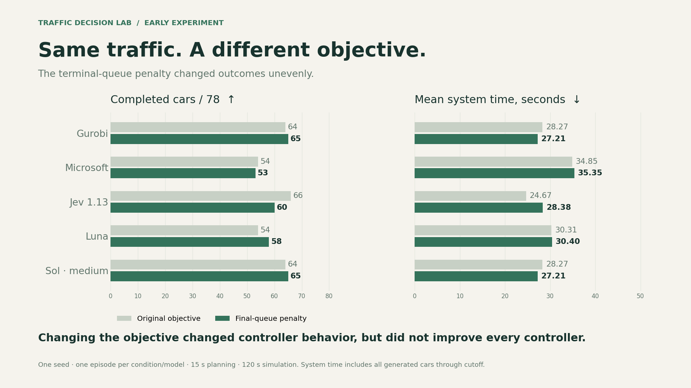

# Traffic Decision Lab

An early experiment in decision-making over a planning horizon: can decision
models make useful traffic-signal choices compared with a mathematical optimizer?

This repository is a work-in-progress record of research and exploration.
It includes the experiment code, saved demonstrations, and early findings.

**Finding: changing the objective changed controller behavior, but did not improve
every controller.** These are single-seed traffic experiments, not evidence of
general long-horizon optimization ability.

[](media/demo.mp4)

[Watch the 42-second browser recording](media/demo.mp4) ·
[Read the five-post thread](marketing/thread.md) ·
[Experiment settings and exact prompts](data/published/traffic-objective-v2/prompts.json)

## The experiment

Gurobi, Microsoft Decision-1, Jev 1.13, Luna Decisions, and Sol medium reasoning
choose NS or EW at one straight-route intersection in SUMO 1.28.0. Controllers
share the observation format, forecast construction, signal constraints, and
objective. They receive phase/timers, NS/EW queue totals, a supplied arrival
forecast, and legal actions. Observation values diverge after different actions;
these closed-loop episodes are not identical optimization instances after that.

The featured comparison uses **78 cars, seed 7, a 15-second planning horizon,
and 120 simulated seconds** per episode. The earlier Gurobi horizons tied on
traffic outcomes; 15 seconds had its fastest mean legal-choice latency.

Original objective:

```text
sum of end-of-step NS/EW queues + 0.5 × initiated switches
```

Revised objective:

```text
original objective + 10 × final modeled NS/EW queue
```

The terminal coefficient was fixed before the rerun. The final queue remains
in the running sum and receives the additional terminal cost once. This is a
queue-model penalty, not a direct count of completed SUMO trips. Capacities
remain 2 vehicles/s under green, 1/s under outgoing yellow, and zero under
all-red. Minimum green/yellow/all-red are 5/3/2 seconds.

## Observed outcomes

| Controller | Original completed /78 | Revised completed /78 | Original mean system s | Revised mean system s |
| --- | ---: | ---: | ---: | ---: |
| Gurobi | 64 | 65 | 28.27 | 27.21 |
| Microsoft | 54 | 53 | 34.85 | 35.35 |
| Jev 1.13 | 66 | 60 | 24.67 | 28.38 |
| Luna | 54 | 58 | 30.31 | 30.40 |
| Sol medium | 64 | 65 | 28.27 | 27.21 |



System time counts every generated car from scheduled departure until arrival
or the cutoff, including entry backlog. Completed-trip travel/wait means
exclude unfinished cars and cannot rank overall performance alone. The CSV
also includes completion, unfinished demand, approach coverage, decision
latency, tokens, and reported cost.

There is one episode per condition/model on one seed. Remote outputs are
stochastic; these differences do not establish a general causal improvement.
SUMO paused during controller computation, so model latency did not add traffic
delay. A zero Gurobi gap concerns its simplified queue model, not globally
optimal SUMO traffic. **No revised-objective frozen optimization benchmark has
been run.** Older independent scores are separate evidence.

## View saved results — no API key or solver needed

With Python 3.9 or later, from the repository root:

```sh
python3 scripts/serve_saved_demo.py
```

Open `http://127.0.0.1:8766/`. Preview the synchronized recordings or record the
browser canvas. This read-only server has no experiment or paid-model endpoints.
The included MP4 plays without starting any server.

## Regenerate the figures and video

Installing the project and media tools requires Python 3.11 or later.

```sh
python3 -m venv .venv
.venv/bin/python -m pip install --upgrade pip
.venv/bin/python -m pip install -e '.[media]'
.venv/bin/python scripts/render_marketing_figures.py
```

Figures are regenerated from the published dataset as PNG, SVG, and PDF. For a
new browser recording, start the saved-demo server, click **Record browser
demo**, and download the recording. Convert it using
`scripts/convert_demo_recording.py`; see the [media instructions](media/README.md).
No new simulation or API calls are needed for this workflow.

## Run new experiments — separate from viewing

Install the simulation package and optional Gurobi binding:

```sh
.venv/bin/python -m pip install -e '.[gurobi]'
.venv/bin/python experiments/replay_sweep.py --horizons 15 --controllers gurobi \
  --output-dir results/new-local-run
```

Gurobi requires a usable license. To run the four remote comparators, copy
`.env.example` to `.env`, supply your own OpenRouter key, and run:

```sh
.venv/bin/python experiments/replay_sweep.py --horizons 15 \
  --controllers gurobi microsoft jev luna sol-medium --workers 4 \
  --output-dir results/new-paid-run
```

The second command makes paid model calls. Failures/interrupted attempts are
preserved, and resume never silently resends them. New experiments use the
current revised objective. Historical source snapshots and prompts are
documented in the [published-data notes](data/published/traffic-objective-v2/README.md).
Model aliases and provider implementations can change; exact remote output
reproduction is not guaranteed.

| Comparator | Requested model | Interface |
| --- | --- | --- |
| Microsoft | `microsoft/microsoft-decision-1` | OpenRouter Decisions |
| Jev | `typesafe/jev-1.13` | OpenRouter Decisions |
| Luna | `openai/gpt-6-luna-decisions` | OpenRouter Decisions |
| Sol | `openai/gpt-6.1-sol` | Chat completions, medium reasoning, strict choice JSON |

The Decisions request changes only the model ID. Sol receives the same state
and question in a chat envelope. All remote models return a first action,
not a full schedule. Gurobi uses one thread and a 0.8-second controller budget;
Sol uses a 4,096-token cap. See [exact protocol details](docs/objective-v2.md).

## Reproducibility and checks

- [Ten paired episode summaries](data/published/traffic-objective-v2/episodes.csv)
- [Full summaries and approach coverage](data/published/traffic-objective-v2/episodes.json)
- [Exact original/revised prompts and example request bodies](data/published/traffic-objective-v2/prompts.json)
- [Settings, model versions, source fingerprints, and limitations](data/published/traffic-objective-v2/metadata.json)
- [Five revised-objective trajectories](data/published/traffic-objective-v2/replays.json)
- [Research plan](docs/research-plan.md), [frozen-instance benchmark](docs/horizon-benchmark.md),
  and [setup details](docs/build.md)

```sh
.venv/bin/python -m unittest discover -s tests -v
.venv/bin/python scripts/check_repository.py
.venv/bin/python scripts/check_publication_security.py
.venv/bin/python scripts/validate_release.py
```

The next research steps are independent demand seeds, harder lookahead cases,
and a new frozen-instance benchmark under the revised objective. The development
fixture, prompt choices, and single seed are disclosed; there is no statistical
significance claim.

See the [security policy](SECURITY.md) and
[pre-publication security review](docs/security-review.md) for the release checks
and their limits. Credentials and private run logs are excluded.

## License

Original project code, documentation, exported pilot data, and generated media
are provided under the [MIT license](LICENSE). SUMO, Gurobi, and other
dependencies retain their own licenses. Third-party papers, API credentials,
model weights, and dependency binaries are not included.
